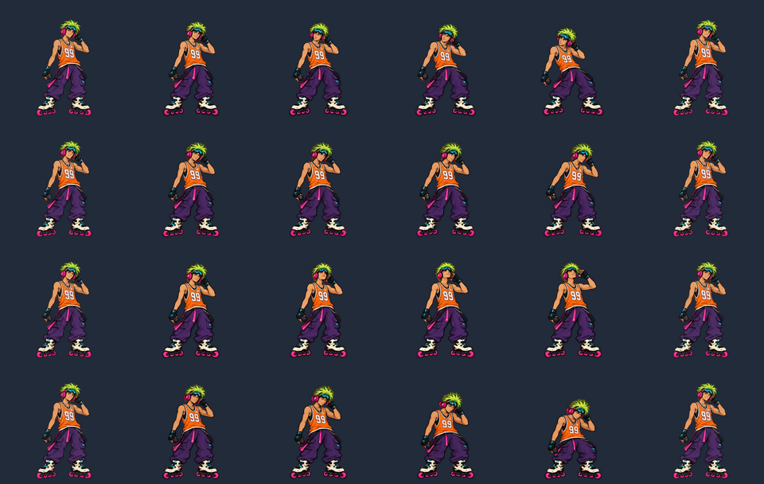

# Browsing reactions

Volt now looks and leans left/right with the CD row, looks up toward a higher
section, and dips toward a lower section. These are four additional whole-body
pose families, independent of the 16 music routines. The preview has hold controls
for all directions, keyboard support, quarter speed, and frame inspection.

The renderer observes the same mutable horizontal/vertical positions used by the
Three.js shelves. No per-frame React updates or new scrolling handlers are needed.
Position changes smaller than 0.045 units/second are treated as settling; a 140 ms
grace period bridges callbacks. Entering takes 0.4 seconds, recovery at most 0.34
seconds. Reversals withdraw through neutral before entering the next direction.
Restored horizontal positions on a different row do not count as swipes.

When motion stops, Volt returns to listening. If music is still playing, he waits
1.2 seconds in idle before resuming its dance. A dance already in progress finishes
its existing recovery first, so a short swipe during a floor routine may only
trigger recovery rather than a directional pose. Opening a case disables new
browsing reactions. Reduced motion keeps the existing static listening/playing cel.

## Artwork and provenance

Built-in image generation created four new four-cel sheets from the accepted
`art/dj-volt/sequence-source.png` identity reference. Prompts and native result
paths are in `art/dj-volt/navigation-prompts.json`. `scroll-*-source.png` are the
accepted immutable sources; `rejected-scroll-horizontal.png` was rejected because
its final poses swapped the microphone hand and directions did not match.

The extractor appends cels 176–191. Each sheet has one scale calibrated from its
neutral drawing; crouches are not stretched. The canvas remains 400×380, with
ground/root at (200,364), front three-quarter view, and the microphone in his right
hand. Registration records contain source hashes, bounds, scale and roots.
Original music routine selection and source records are unchanged.

## Verification

Run `node scripts/verify-volt-navigation.mjs` with `PLAYWRIGHT_MODULE` set when
Playwright is external, and `VOLT_URL` pointing at the local dev server.

- Deterministic 60/120 Hz fixtures: all directions, reversal through neutral,
  complete recovery, restored-row position and disabled inputs.
- Actual Chrome character preview: all directions at normal and quarter speed,
  music interruption → idle → music resume (including a 100 ms swipe during a windmill), reduced motion, no page errors.
- Actual app: desktop keyboard and wheel, phone-sized touch swipes, all four
  directions observed and final idle state. Sample mode, no Spotify sign-in.
- Existing 16-routine playback/pause recovery and the complete sample pick/open/play/return flow passed on desktop and phone in Street/Paper/Street.
- `npm run build` passed in an identical temporary copy. Existing large-bundle
  warning remains.

Evidence: `output/dj-volt/navigation-1792638445420/`. Preview callback gaps were
median/p95 16.7 ms, p99/max 16.8 ms, with no gaps over 34 ms. These are rAF
observations in headless Chrome, not display-scanout measurements or a physical
phone performance claim. Full-app software WebGL runs substantially slower.

`scroll-reactions.mp4` preserves the recorded timing and contains both speeds.
Source sheets, registered boundary frames, and rendered peaks were inspected:
hands/equipment remain consistent, gestures read in the requested direction,
and all figures fit the canvas. There is visible cel-to-cel drawing variation.
Exact anatomical support-foot drift and independent human motion review remain
unmeasured; atlas contact bounds alone do not prove zero foot slip.
