# Tokyo Street background

Current review pass (round 30): desktop 1280×760 and touch phone 390×800, using sample CDs. The source screenshots and automated output remain in `output/tokyo-verification/round-30/` locally.

## Day

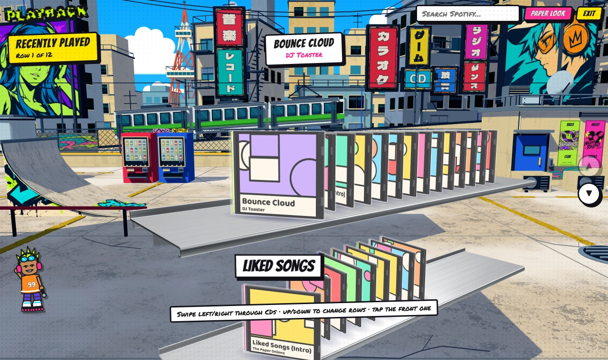
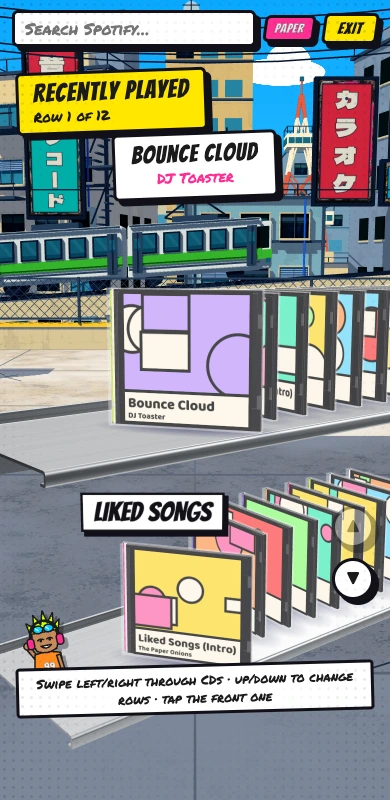

## Sunset

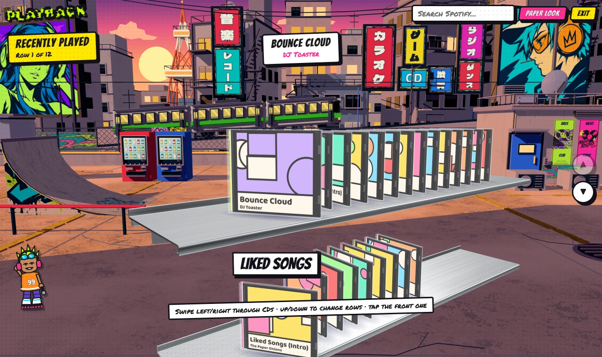
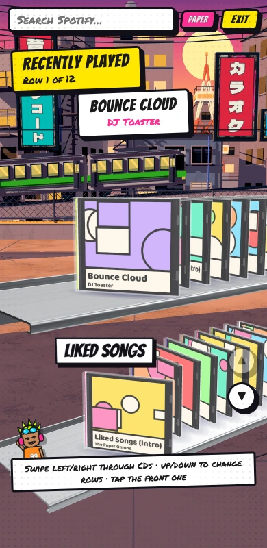

## Night

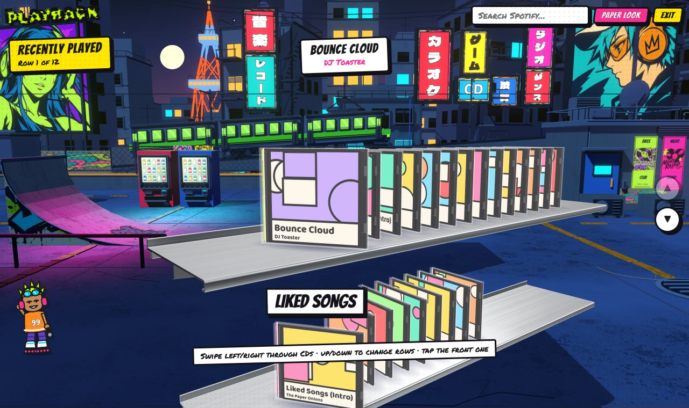
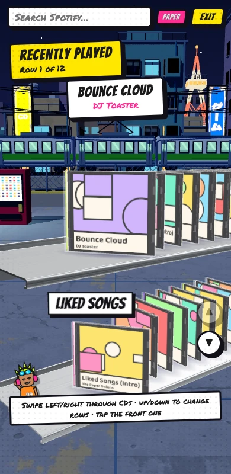

## First pass / current pass

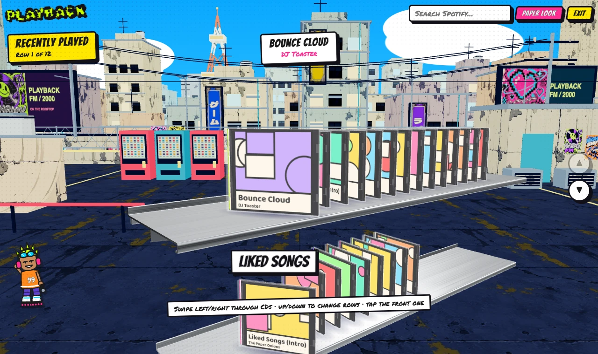

## Model detail and Japanese type proof

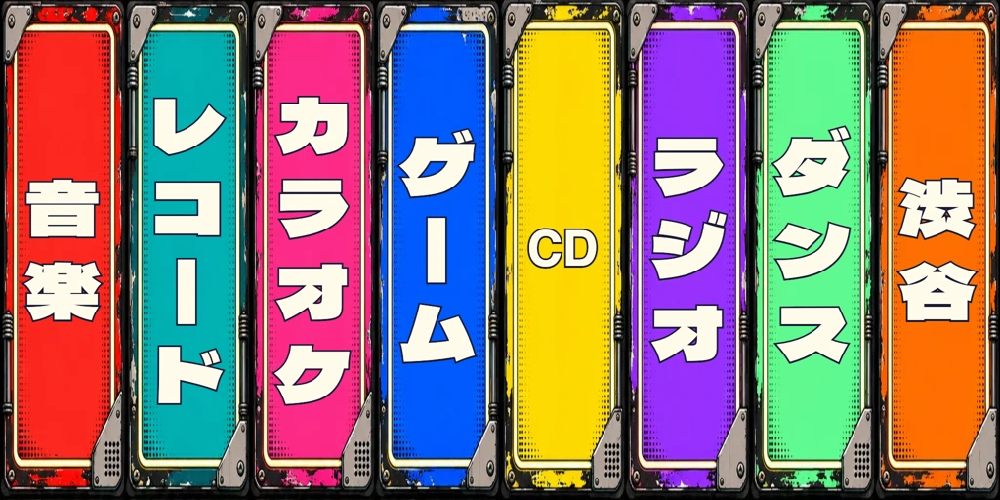

## Approved target concepts

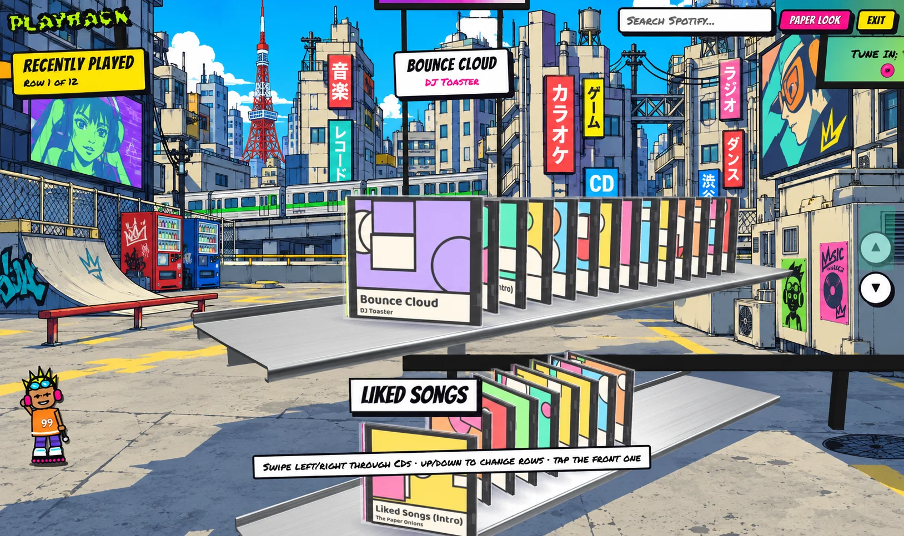
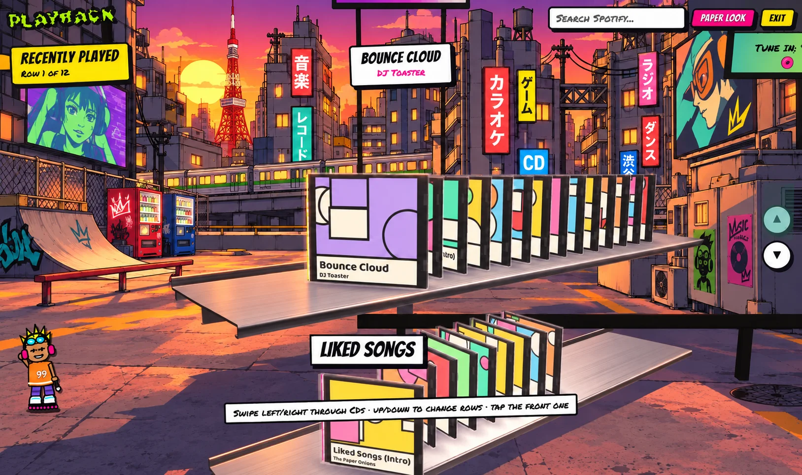
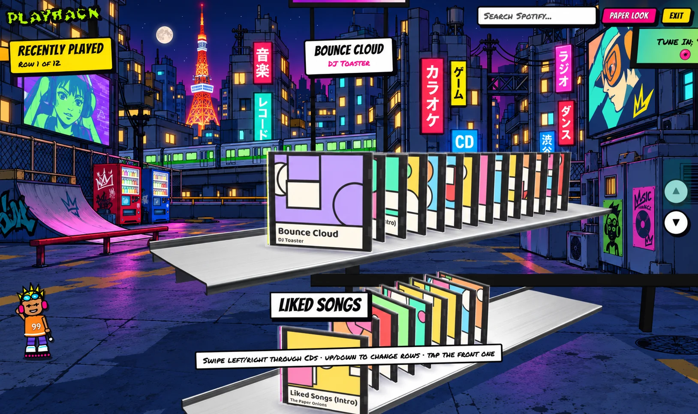

## Squint review

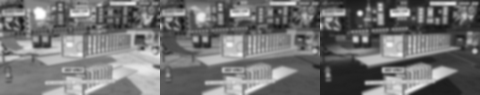
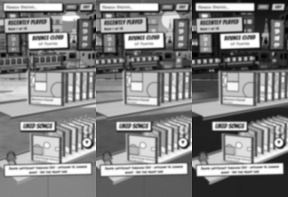

## Direct reference comparisons

Approved concept on the left; current application on the right. These are visual evidence, not pixel-match acceptance tests.

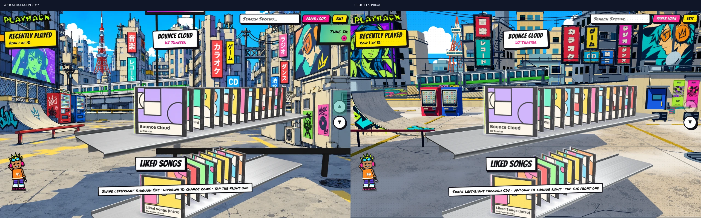
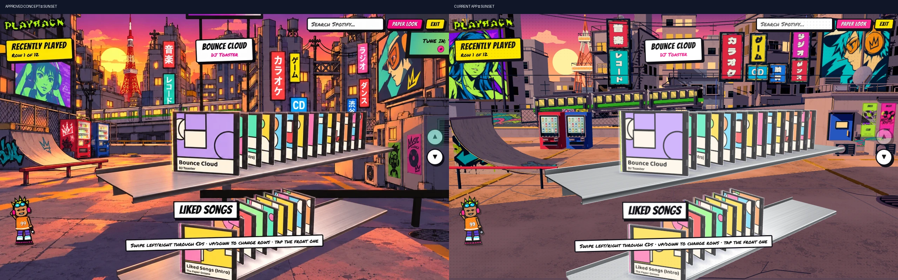
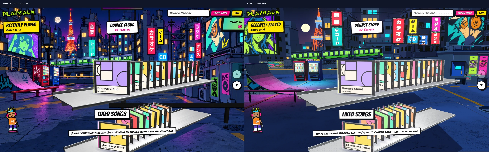

## Equipment under each light

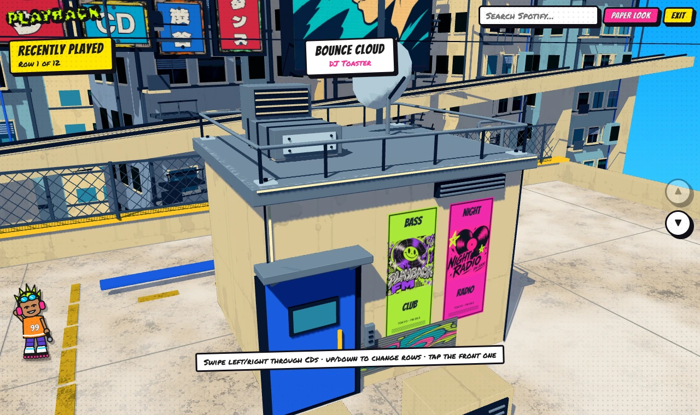
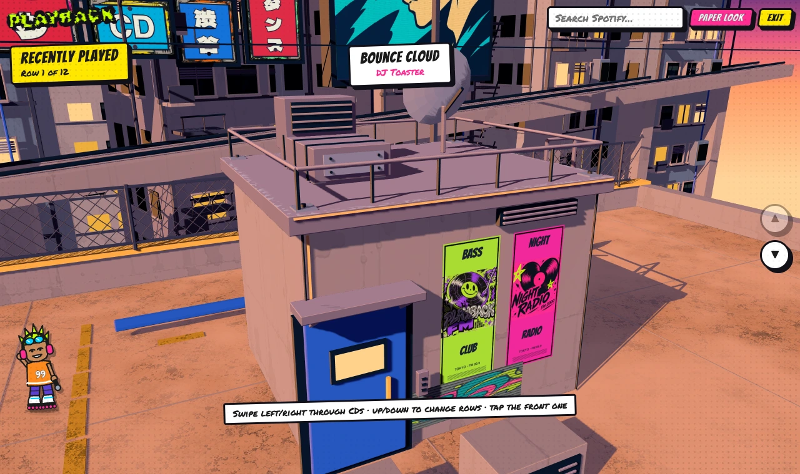
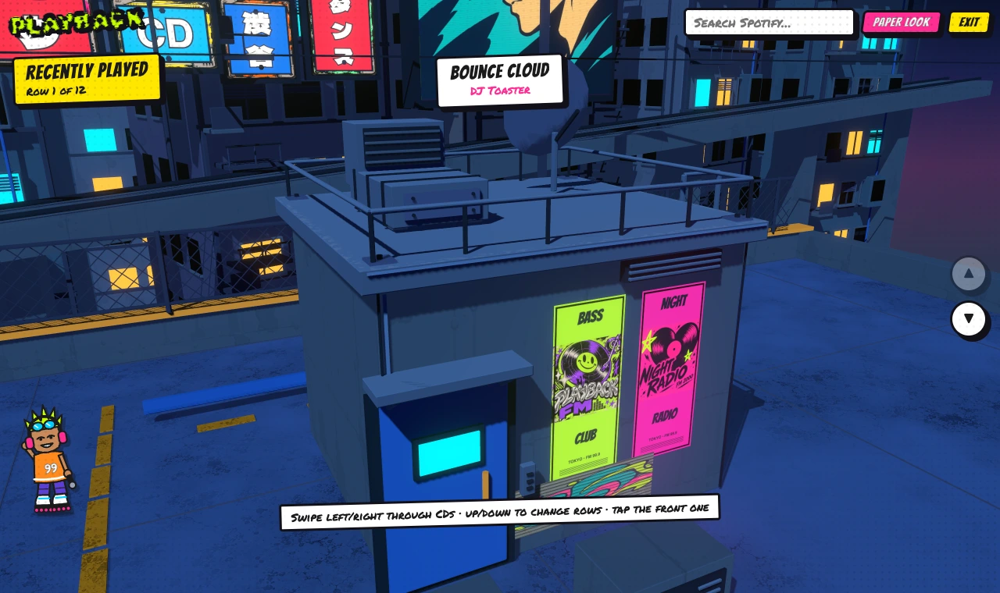
