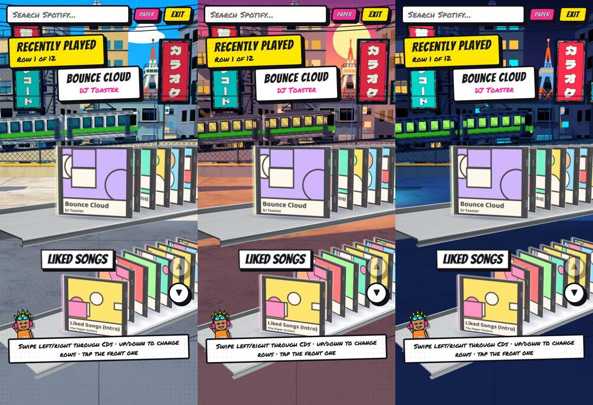

# iPhone rendering memory fix

An iPhone 17 Pro Safari crash was reported after the Tokyo background went live. The code allocated an 8192×8192 shadow target on phones whenever the GPU advertised support for that texture size. Maximum texture dimensions do not establish an available memory budget. The 3D canvas also forced DPR2 on phones.

This is a likely source of GPU memory pressure, not a confirmed diagnosis from a device crash log. [Three.js's shadow guide](https://threejs.org/manual/pages/shadows.html) describes the memory/rendering cost of larger shadow maps.

Touch devices now use a 2048×2048 shadow target and DPR1.5 for Street. Shadow pixel count falls by 93.75%; the canvas pixel count falls by 43.75%. Geometry, textures, colors and desktop settings are unchanged. Paper retains its adaptive DPR. Selection uses coarse primary input, so rotating a phone into landscape does not select desktop buffers. Hardware texture limits still apply.

Validation:

- Type-check and production build pass (existing bundle-size warning).
- Six Chrome captures at 1280×760 and 390×800 pass with no browser/contract errors. The phone profile uses device scale factor 3. Actual allocated shadow targets and renderer pixel ratios are asserted.
- Desktop and phone sample CD pull/open/play/return, row navigation, moving train, Paper and Street switching pass.
- Desktop WebKit with a high-density touch profile passes three portrait/landscape cycles and two Paper/Street round trips. Each view runs through billboard refreshes. No page errors, crashes or WebGL context loss were observed; texture counts stay at 88 portrait / 103 landscape across cycles. This used the installed WebKit 2359 executable, not physical iOS Safari.
- Physical iPhone Safari and real Spotify playback remain unverified. Browser emulation does not reproduce iOS process memory limits.

The earlier round-32 gallery records the original DPR2 configuration. This fix supersedes its phone buffer settings without replacing that historical review record.
